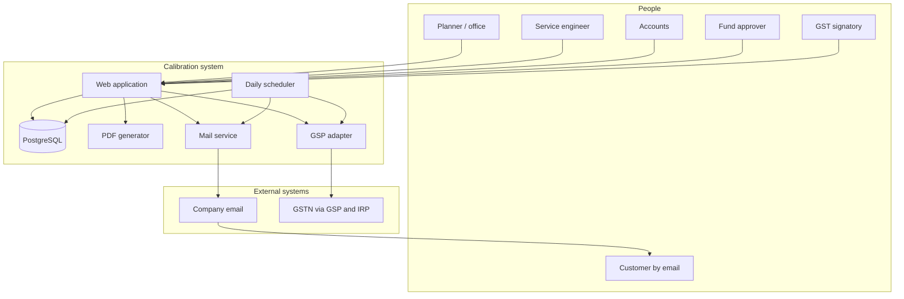
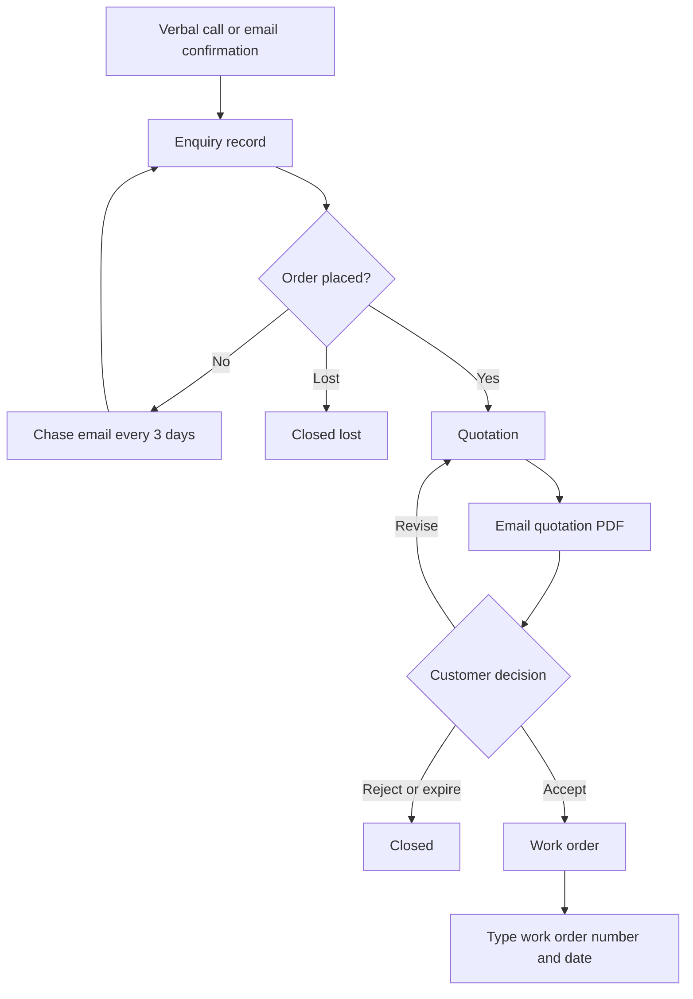
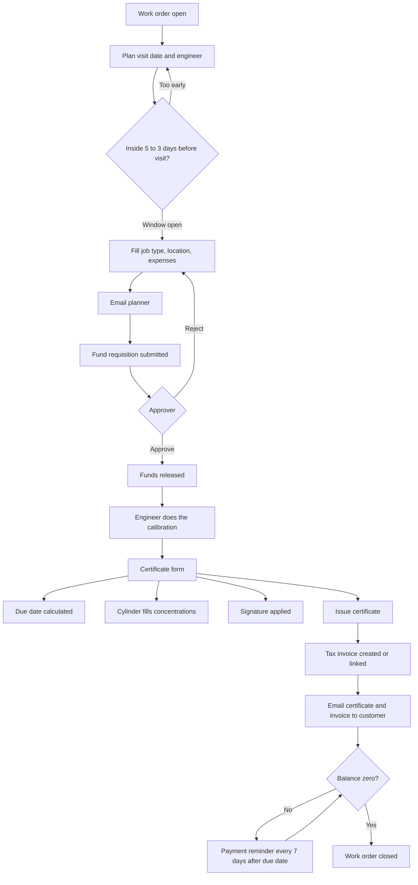
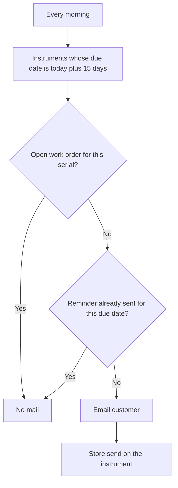
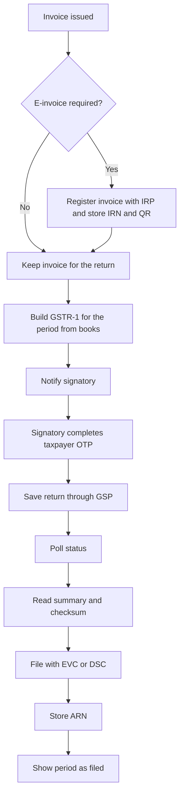

# Firstly Calibration System

## Using the application

Open `index.html` in a browser. Tailwind loads from the CDN, so the machine needs a network connection. The sign-in page offers two sample accounts for a quick start: `admin@firstly.test` / `Admin@1234` and `accounts@firstly.test` / `Accounts@1234`. If the registers are empty, the first load fills customers, instruments, jobs, certificates, invoices, stock, and mail from the current calibration desk.

Records stay in this browser under the local storage key `firstly-cal-v2`. An administrator can download a JSON backup from Settings and restore it later. Restoring signs you out. Erase installation removes every record, including users.

Email is prepared in the mail log and opened in the computer’s mail application. The application does not send mail and does not mark a message as sent. Payment reminders, calibration-due reminders, and confirmation chases are prepared once each Asia/Kolkata day when someone is signed in.

GSTR-1 is not filed from this application. GST shows the outward supplies for each invoice month and downloads a JSON file. After the authorised signatory files on the GST portal, or through a GST Suvidha Provider, accounts record the ARN from that acknowledgement. An IRN is pasted onto an invoice only after the Invoice Registration Portal issues it. The application does not generate an IRN, an ARN, or a QR code.

The sections below are the business specification this application follows.

Planning document for the calibration operations, billing, stock, visit, and GST system.

The workspace is a new project. The design follows how industrial gas-monitor calibration is actually recorded, how Indian GST returns are filed, and the stack already used in this company’s other web apps (Next.js, React, PostgreSQL).

## 1. What the business does

The system supports a calibration service company that calibrates gas detection instruments and then bills the customer.

Three instrument families share one certificate engine and three print layouts:

| Option | Typical use | Certificate layout |
| --- | --- | --- |
| Portable monitor | Handheld / personal gas detector carried by the user | Portable certificate |
| Fixed monitor | Permanently installed detector on a plant or panel | Fixed-system certificate |
| Area monitor | Open-area or zone gas monitor | Area-monitor certificate |

A job starts as a verbal or email confirmation, or as a written enquiry. Office staff raise a quotation. After the customer places the order, a work order is opened. A service engineer visits or the instrument is received in the workshop. The engineer records the calibration, the system prints the certificate with the engineer’s stored signature, raises the tax invoice, and emails both documents to the customer. Reminders run on their own for the next calibration, for unpaid invoices, and for confirmations that never became orders. Accounts push the month’s outward supplies into GSTR-1 through a GST Suvidha Provider. Travel funds are requested on the portal and released only after approval.

## 2. Research that shapes the design

### Calibration record

Industrial and marine practice records, for each instrument, the serial number, the calibration gas used, the calibration date, the person who did the work, and the next due date. Manufacturer guidance for direct-reading portable gas monitors commonly puts span calibration in a 30 to 180 day band. Fixed monitors are often checked on a 4 to 6 month cycle, with a longer span interval unless the site procedure is tighter. The three intervals in this product — 3 months, 4 months, and 6 months — match that operating range. The user selects the interval; the due date is calculated.

A NABL / ISO/IEC 17025 certificate states what was measured on the calibration date. Accreditation practice treats the next-due date as the customer’s interval, printed because the customer asked for it. This product prints it, labelled as the calibration due date selected for that instrument.

Useful certificate content, beyond the fields that are typed by hand, is stored so the PDF is acceptable to a plant auditor:

- Customer name, site, and instrument location or tag
- Make, model, and range
- Certificate number and issue date
- Calibration method in short form (zero and span, or the method the company uses)
- Cylinder number, gas description, certified concentration, unit, and cylinder expiry
- Result per gas (before adjustment and after adjustment when both are taken)
- Environment at the time of calibration (temperature; humidity when recorded)
- Engineer name, designation, and soft-copy signature
- Work order number and work order date
- Statement that the due date follows the selected 3, 4, or 6 month interval

Reference-standard traceability (the cylinder’s own certificate number) is a master-data field on the cylinder. The certificate prints it when it is on file.

### Gas and cylinder

Span gas is a certified mixture. A cylinder is either single gas (one component) or multi gas (several components in one cylinder). The certificate must not ask the engineer to retype concentrations that already exist on the cylinder record. Selecting the cylinder fills the gas lines. The engineer can drop a line that was not required on that job. Adding a gas that is not on that cylinder is blocked.

Illustrative profiles for master data (real values always come from the cylinder certificate, not from this table):

| Profile | Components |
| --- | --- |
| Single gas, combustible | Methane, 50% LEL |
| Single gas, oxygen | Oxygen, 18.0% vol |
| Single gas, carbon monoxide | CO, 100 ppm |
| Single gas, hydrogen sulphide | H2S, 25 ppm |
| Multi gas, four gas | Methane 50% LEL, O2 18.0% vol, CO 100 ppm, H2S 25 ppm |

### GST

Calibration and technical testing are normally classified under SAC **998346** (technical testing and analysis services), printed as **99834600** where an 8-digit code is required. The standard rate is **18%** (CGST 9% + SGST 9% intra-state, or IGST 18% inter-state). Government testing and calibration done by a government authority can be exempt under a different entry. This company’s own invoices use 998346 at 18% unless a tax advisor records a different code in settings. The rate is a setting, not a hard-coded assumption that can drift when a notification changes.

Outward B2B invoices belong in GSTR-1. Filing is a GSTN transaction. It is available to software only through an empanelled GST Suvidha Provider (GSP), using the taxpayer’s own GST portal user. The legal sequence is:

1. Authenticate the GSP application.
2. Authenticate the taxpayer. GSTN sends an OTP to the registered mobile or email. The session is short (about six hours) and can be extended only before it lapses.
3. Save the GSTR-1 payload (B2B invoices, credit notes, SAC summary, documents-issued).
4. Poll status until the portal accepts the save.
5. Initialise filing and read the section summary and checksum.
6. File with EVC (another OTP) or a digital signature certificate (DSC) of the authorised signatory.
7. Store the acknowledgement reference number (ARN).

E-invoice (Invoice Registration Portal, IRN and signed QR) applies when the company’s aggregate annual turnover crosses the notified threshold. Public guidance in force while this plan was written puts that threshold at ₹5 crore. Confirm the live threshold before go-live. Where e-invoice applies, the invoice is registered with an IRP at issue time. Those IRNs auto-populate GSTR-1. The return is still reviewed and filed; it is not created by retyping each invoice. Where e-invoice does not apply, this system builds the GSTR-1 tables from its own invoices.

Rule 59(6) of the CGST Rules blocks GSTR-1 filing when the required earlier GSTR-3B is pending. The product surfaces that rejection. It does not file GSTR-3B in the first release.

“GST track record” uses two legal sources:

- Own returns: ARN, period, status, and error text from the GSP after each save or file.
- Customer GSTIN: public GST APIs (via the same GSP) for legal name, status, and return-filing track by financial year. Taxpayer OTP is not required for the public track.

The product does not log into gst.gov.in with a scripted browser. Portal credentials and OTPs are entered by the authorised signatory at filing time and are not stored as reusable passwords.

### Mail

Certificate, invoice, due-date, payment, and order-chase emails are transactional messages from the company’s own domain. Each send is logged with the template, recipient, provider id, and success or failure. A failed send is retried. A permanently failed address is shown on the customer record.

### What this plan treats as settled

| Topic | Rule |
| --- | --- |
| Due date | Calibration date plus 3, 4, or 6 calendar months. Day 31 clamps to the last day of the target month. Example: 31 January + 3 months = 30 April. |
| Due reminder | One email per instrument, 15 days before the due date. Suppressed when a new open work order already exists for that serial number. |
| Payment reminder | Starts the day after the invoice due date, then every 7 days, until the balance is zero, the invoice is cancelled, or a user stops reminders. Default invoice credit period is 30 days. Both numbers are settings. |
| Order chase | Every 3 days to the customer while a verbal or email confirmation stays unconverted. Stops when a quotation is accepted or a work order is opened, or when a user marks it lost. |
| Visit pack | The visit form is due in the window from 5 days before the visit through 3 days before the visit. Submission emails the planner. Funds move to released only after approval. |
| Work order number | Typed by the user, with the work order date. The system still keeps its own job number. |
| Signature | Stored soft-copy image of the engineer, applied when the certificate is issued. |
| Money | Stored in paise. Documents show rupees. |

## 3. How the system works

One PostgreSQL database holds customers, instruments, commercial documents, calibration results, stock, and GST payloads. Users work in a web application. A scheduler inside the same application runs the date-driven emails and GST status polls. PDF files for quotations, certificates, and invoices are generated on the server and stored. Email goes out through SMTP. GST calls go out through one GSP adapter so the rest of the system never depends on a single vendor’s field names.

Nothing is posted by a background job that needs a human legal act. The scheduler prepares GSTR-1 and notifies the signatory. The signatory files it. The scheduler does send the operational emails listed above, because those were requested as automatic.

## 4. Roles

| Role | Can do |
| --- | --- |
| Admin | Users, company profile, tax, email templates, reminder timings, gas profiles, all records |
| Planner | Enquiries, quotations, work orders, visit calendar, planner approval queue, customer and instrument register |
| Engineer | Own visits, calibration entry, certificate draft for assigned jobs, cylinder issue from stock, own fund requisition |
| Accounts | Invoices, receipts, credit notes, payment reminder control, GST workspace, stock valuation view |
| Approver | Fund requisition decision and release. Often the same person as Planner; the permission is separate so a director can approve without editing jobs |
| Signatory | GST OTP, GSTR-1 file, e-invoice retry. Usually Accounts or a director |

A user may hold more than one role. Every write stores the user id and time. Issued certificates, sent invoices, filed returns, and approved requisitions are not edited in place. A change creates a revision, a credit note, or a new decision.

## 5. Modules and pages

Navigation is the module list. Each page below is a screen to build.

### Dashboard — `/`

Counts that need a person today: quotations waiting, visits inside the 5-day window with an empty pack, fund requests pending, certificates drafted and not issued, invoices unpaid, reminder failures, GSTR-1 period not filed, cylinders expiring or below reorder. Each count opens the filtered list.

### Customers — `/customers`, `/customers/[id]`

Legal name, trade name, GSTIN, state code, billing and site addresses, contacts, email used for certificates and for chasers, phone, payment terms. Saving a GSTIN calls the public GST API and stores legal name, registration status, and the last check time. The customer page lists instruments, quotations, work orders, invoices, and open verbal confirmations.

### Instruments — `/instruments`, `/instruments/[id]`

One row per physical monitor at a customer: family (portable, fixed, area), make, model, serial number, tag, site, selected interval (3, 4, or 6 months), last certificate, next due date. Serial number is unique per make. The due-date job reads this register.

### Gas profiles — `/settings/gases`

Named single-gas and multi-gas profiles: each line has gas, concentration, unit (`ppm`, `% LEL`, `% vol`). Profiles are templates. A cylinder stores the certified values copied from its certificate, which may differ from the template.

### Enquiries and verbal or email confirmations — `/enquiries`, `/enquiries/[id]`

Source is phone or verbal, or email. Fields: customer, contact, date of confirmation, job summary, site, rough instrument list, owner. Status path: open → chasing → converted → lost. Convert opens a quotation with the summary copied in. The chase mail is described in the workflow section.

### Quotations — `/quotations`, `/quotations/new`, `/quotations/[id]`

Format of the PDF and of the screen:

- Company letterhead, address, GSTIN, phone, email
- Quotation number `QT-YYYY-####`, date, validity date (default 15 days)
- Customer billing details and site
- Subject line, for example calibration of portable and fixed gas monitors
- Lines: instrument family, make and model, serial or quantity, charge, SAC 998346
- Optional lines: visit charge, mobilisation, spare or sensor, cylinder consumption
- Discount if any, taxable value, CGST and SGST or IGST, round-off, grand total
- Notes, validity, calibration interval offered, bank details
- Prepared-by name

Actions: save draft, mark sent (emails the PDF), revise (new version, old version kept), mark accepted, mark rejected, mark expired. Accepted quotation can create the work order. Prices come from a rate card that the user may override on the line.

### Work orders — `/work-orders`, `/work-orders/[id]`

Internal job number `JOB-YYYY-####` is automatic. Work order number and work order date are typed. The order points at the customer, the accepted quotation when there is one, the site address, and the instrument lines. Status: draft, scheduled, in progress, calibrated, certified, invoiced, closed, cancelled. Each instrument line later points at one certificate.

### Visit schedule — `/visits`, `/visits/[id]`

Calendar and list of engineer visits.

Filled by the engineer or planner inside the T−5 to T−3 window:

- Visit date and reporting time
- Engineer
- Job type: site calibration, workshop calibration, installation, breakdown, demonstration
- Location: site name, address, map link or landmark, contact person and phone
- Instrument count and families
- Transport mode, estimated travel cost, other expense lines
- Notes for the planner

Submitting the pack emails the planner and opens the fund requisition. A visit dated sooner than three days needs an admin or planner override that is stored with a reason.

### Fund requisitions — `/requisitions`, `/requisitions/[id]`

Number `FR-YYYY-####`. Linked to the visit. Status timeline the user can read without asking anyone: draft, submitted, approved, rejected, released, closed. Approval records the approver, time, and amount released. Rejection records the reason and returns the pack to the engineer. Release is a status, not a bank payment API. Accounts can mark the amount as paid out to the engineer and later match an expense statement. The requisition page is the tracking portal described in the requirement.

### Calibration and certificates — `/certificates`, `/certificates/new`, `/certificates/[id]`

Entry is per instrument line on a work order.

The user types:

- Instrument family, which selects the PDF layout
- Calibration date
- Interval: 3 months, 4 months, or 6 months
- Serial number (checked against the instrument register)
- Cylinder number (chosen from stock)
- Work order number and work order date

The system fills:

- Due date from calibration date and interval
- Gas lines and concentrations from the cylinder
- Engineer soft-copy signature and printed name of the logged-in engineer, or of the engineer selected on the job
- Certificate number `CAL-YYYY-####`

The user confirms which of the cylinder’s gases were required, and enters the instrument reading after gas is applied (and the as-found reading when the procedure captures it).

Actions: save draft, preview PDF, issue. Issue locks the certificate, writes the instrument’s next due date, moves the linked cylinder use onto the job, generates the invoice if Accounts has not already raised one, and emails the certificate PDF and the invoice PDF to the customer. A mistake after issue is a revised certificate: new number suffix `-R1`, previous certificate marked superseded, customer emailed the revision.

### Invoices and receipts — `/invoices`, `/invoices/[id]`, `/payments`

Tax invoice PDF:

- Company legal name, address, GSTIN, state
- Invoice number `INV-YYYY-####`, date, place of supply, work order number
- Customer name, billing address, GSTIN, ship-to site
- Lines copied from the job, SAC, taxable value, tax split, total in figures and words
- IRN and QR when e-invoice applies
- Bank details and authorised signatory image
- Balance and due date

Receipts record amount, date, mode (bank, UPI, cash, cheque), and reference. Partial receipts reduce the balance. The reminder job uses the balance. Cancel before filing issues no GSTR row. Cancel after the invoice is in a filed period issues a credit note `CN-YYYY-####`, which enters the next GSTR-1.

### Stock — `/stock/cylinders`, `/stock/spares`

Cylinders:

- Cylinder number, unique
- Single gas or multi gas
- Component lines: gas, certified concentration, unit
- Supplier, certificate number of the gas, fill date, expiry date
- Pressure or status note, location (store, engineer, site)
- Status: in stock, issued, empty, expired, quarantined

A certificate can select a cylinder that is in stock or already issued to that work order, and whose expiry is after the calibration date.

Spares and sensors:

- Item code, name, unit, quantity on hand, reorder level, location
- Receipt, issue to a work order, return, adjustment with reason

Low stock and expiry inside 30 days show on the dashboard.

### GST — `/gst`, `/gst/[period]`

Period workspace for the company’s GSTIN:

- List of invoices and credit notes in the period and which GSTR-1 table they feed (B2B, B2C small, credit/debit notes, SAC summary, documents issued)
- Totals matched to the invoice register
- e-invoice status per invoice when the company is in scope
- Save to portal, portal status, summary, file action for the signatory
- ARN and a download of the filed acknowledgement text
- Blocker text when GSTR-3B for the prior period is outstanding
- Customer GSTIN health: inactive GSTINs and customers whose public return track shows a missed GSTR-1 or GSTR-3B

### Mail log — `/mail`

Every automatic and manual email: type, customer, document, time, result. Resend from this screen.

### Reports — `/reports`

Due in the next 30 days, overdue instruments, unpaid invoices and ageing, quotation conversion, engineer visit plan for the week, cylinder expiry, fund released and not closed, GSTR-1 versus books for a period.

### Settings — `/settings`

Company and letterhead, logo, GSTIN, state, bank, invoice credit days, SAC and rate, e-invoice on or off, GSP credentials (API key only), reminder schedules, email templates, users and roles, engineer signature images, rate card, document prefixes.

### Login — `/login`

Email and password. Session cookie. No customer login in the first release. Customers receive PDFs by email.

## 6. Requirement coverage

| # | Requirement | Where it lives |
| --- | --- | --- |
| 1 | Certificate for portable, fixed, or area monitor | Certificate module, three layouts, shared data |
| 1.i | Calibration date typed; due date from 3, 4, or 6 months | Certificate form |
| 1.ii | Serial number typed | Certificate form, checked on the instrument register |
| 1.iii | Cylinder number typed or picked; concentration from single-gas or multi-gas cylinder | Cylinder stock and certificate gas lines |
| 1.iv | Engineer signature applied from the stored soft copy | Engineer profile, stamped at issue |
| 1.v | Work order number and date typed | Work order and certificate |
| 2 | After the certificate is issued, email the customer the certificate and the invoice | Issue action |
| 3 | 15 days before due date, email the customer | Daily scheduler on the instrument register |
| 4 | Quotation format | Quotation module and PDF |
| 5 | Invoice, and reminder mail while payment is pending | Invoice module and scheduler |
| 6 | Stock | Cylinders and spares |
| 7 | Visit schedule with job type and location, filled 3 to 5 days ahead, mail to the planner, funds after approval | Visits and requisitions |
| 8 | Verbal or email confirmation chased until an order exists | Enquiries |
| 9 | After invoices exist, submit GSTR-1 | GST workspace through a GSP, signatory files |
| 10 | GST track record found automatically | Own ARN log and public GSTIN return track |
| 11 | Fund approval requested on the portal and easy to track | Requisition timeline |

## 7. Workflows

### Commercial path

A quotation may also be raised with no enquiry, for a customer who already sent a written request. The chase applies only while the enquiry is still a verbal or email confirmation with no accepted quotation and no work order.

### Visit, funds, calibration, invoice

Workshop jobs with no travel still use a work order and a certificate. The visit pack and fund requisition are skipped when job type is workshop and the expense total is zero.

### Due-date reminder

### GSTR-1

Public customer GSTIN checks run when a GSTIN is saved and again on a weekly pass over active customers. Failures are listed on the GST page. They do not block a certificate.

## 8. Document states

| Document | States |
| --- | --- |
| Enquiry | Open, chasing, converted, lost |
| Quotation | Draft, sent, accepted, rejected, expired, revised |
| Work order | Draft, scheduled, in progress, calibrated, certified, invoiced, closed, cancelled |
| Visit | Planned, pack due, pack submitted, done, cancelled |
| Requisition | Draft, submitted, approved, rejected, released, closed |
| Certificate | Draft, issued, superseded |
| Invoice | Draft, issued, partly paid, paid, cancelled |
| Credit note | Issued, included in return |
| GSTR-1 period | Open, saved, filed, rejected |
| Cylinder | In stock, issued, empty, expired, quarantined |

## 9. Data the screens share

These are the records, not a physical database diagram. Names can change during implementation. Relationships should not.

- Company, tax setup, rate card, templates, users, engineer signatures
- Customer, site, contact
- Instrument, with family, serial, interval, current due date
- Gas profile and gas line
- Cylinder and cylinder gas line
- Spare item and stock movement
- Enquiry
- Quotation, quotation version, quotation line
- Work order and work-order instrument line
- Visit and fund requisition, requisition event
- Certificate, certificate gas result
- Invoice, invoice line, receipt, credit note
- GST period, GST payload log, ARN
- Email log
- Audit event

Certificate gas results are copied onto the certificate at issue time. Later edits to the cylinder master do not change an issued certificate.

## 10. Emails

| Mail | When | To | Attachments |
| --- | --- | --- | --- |
| Quotation | User marks sent | Customer contact | Quotation PDF |
| Planner pack | Visit pack submitted | Planner | None. Body has job type, location, date, engineer, amount |
| Fund decision | Approved or rejected | Engineer and planner | None |
| Certificate and invoice | Certificate issued | Customer accounts email | Certificate PDF, invoice PDF |
| Certificate revision | Revision issued | Customer | Revised certificate PDF |
| Due in 15 days | Daily job | Customer | None, or the previous certificate if still on file |
| Payment pending | Daily job, schedule above | Customer | Invoice PDF |
| Order not yet placed | Every 3 days | Customer contact on the enquiry | None |
| GSTR-1 ready | Period has issued invoices and the filing window is open | Signatory | None |
| Mail failure | Provider rejects | Planner or accounts | None |

Templates use the company name, document numbers, dates, and amounts from the database. The wording is editable in settings. The senders are the company’s addresses, for example certificates and accounts.

## 11. Technical requirements

### Application

- Web app: Next.js (App Router), React, TypeScript. This matches the company’s existing nursing-home application and keeps one deployment style.
- Database: PostgreSQL. Money in integer paise. Dates as calendar dates in `Asia/Kolkata`.
- Server-rendered pages and server actions for forms. Role checks on every write, not only in the menu.
- PDF: server-side HTML to PDF with the company logo from `Firstly_logo.png` (or a copy placed in the project when build starts). Three certificate bodies, one quotation body, one invoice body.
- Files: signature images and generated PDFs on disk or object storage, served only to a logged-in user who may see that customer.
- Mail: SMTP with a provider the company already controls. Queue table so a restart does not lose a send.
- Scheduler: a single daily job for due dates, payment reminders, enquiry chases, cylinder expiry, and GST “ready to file” notices, plus a short poll only while a GSTR-1 save is in progress. Visit-window warnings run in the same daily job.
- Authentication: email, password hash, httpOnly session cookie. Password reset by an admin in the first release.
- Audit: user, time, entity, and a short description for issue, cancel, approve, release, file, and stock adjustment.

### GST adapter

- One interface: `validateGstin`, `registerInvoice`, `saveGstr1`, `gstr1Status`, `gstr1Summary`, `fileGstr1`, `trackReturns`.
- First implementation targets one GSP the company contracts (Clear, IRIS, Cygnet, or another empanelled provider). Sandbox credentials are a setting separate from production.
- E-invoice payload follows the IRP invoice schema for B2B services: supplier, recipient, document number and date, SAC line, tax, and value. The QR returned by the IRP is printed on the invoice PDF.
- The signatory’s GST password is not written to the database. OTP entry is a screen that posts straight to the GSP session call.
- Production GST calls are disabled until Admin turns the company GST switch on. Until then the GST page shows the prepared tables and marks them “not submitted”.

### Certificate rules in code

- Family is required and is one of portable, fixed, area.
- Interval is required and is one of 3, 4, 6.
- Due date is computed. The field is read-only.
- Cylinder must match the calibration date and must not be expired, empty, or quarantined.
- At least one gas line from that cylinder must remain on the certificate.
- Concentrations on those lines are read-only and equal to the cylinder certificate values.
- Issue requires calibration date, serial, cylinder, work order number, work order date, engineer signature on file, and a customer email.
- Issue is idempotent: repeating the action does not create a second invoice or a second email.

### Visit rules in code

- Pack submit is allowed when the visit date is 3, 4, or 5 days ahead, or when an override is stored.
- Submit sets requisition status to submitted and emails the planner once.
- Released amount is set only by a user who has the approver permission, and only from submitted.
- An engineer cannot approve their own requisition.

### Stock rules in code

- Issuing a cylinder decrements availability and links it to the work order.
- Empty and expired cylinders do not appear in the certificate picker.
- Spare issue cannot exceed quantity on hand.
- Adjustment requires a reason.

### Non-functional

- Daily backup of PostgreSQL and of the PDF and signature folder.
- HTTPS in any shared deployment.
- GST API secrets and SMTP passwords only in environment variables.
- Certificate and invoice numbers never reused, including after cancellation.
- Time zone and financial year (April to March) fixed for GST periods.

## 12. Build order

All eleven requirements are in scope. The order below is the sequence of construction so each step can be tried against the previous one.

1. Company settings, users, customers, instruments, gas profiles, cylinder and spare stock.
2. Enquiries, quotations and quotation PDF, work orders.
3. Visit pack, planner email, fund requisition and approval.
4. Certificate entry, due-date calculation, signature, PDF for the three families, issue lock.
5. Invoice PDF, receipt, combined email on issue.
6. Schedulers: 15-day due mail, payment reminder, enquiry chase, mail log.
7. GSTIN check, e-invoice when enabled, GSTR-1 prepare, save, and file, plus the track screens.
8. Reports and dashboard counts.

Each step is done only after the screens in that step match this document. GST production filing waits until a GSP contract, a sandbox test period, and a signatory rehearsal are finished.

## 13. Items to confirm before build

These do not block the data model. They change copy, tax, and the GSP contract.

- Legal name, GSTIN, address, bank, and logo lockup for the PDFs
- Whether the company is above the e-invoice turnover threshold
- GSP vendor and whether filing will use EVC or DSC
- Default credit days and whether payment reminders should also go to a second customer address
- Whether workshop jobs always skip the fund requisition
- Rate card: per instrument family, per visit, or a quoted lump sum
- Certificate wording required by the company’s customers (some sites ask for a specific sentence on traceability)
- Email domain and mailbox names

## 14. Sources used for this plan

- ISO/IEC 17025 practice as described in NABL certificate guidance: calibration date is the measured date; the interval is chosen for the instrument’s use. NABL 138 specific guidance on reference gas mixtures and air-quality equipment (traceable span gas, cylinder condition).
- Manufacturer service guidance for portable and fixed gas detection: span and accuracy intervals commonly fall between one month and six months depending on instrument type.
- CPCB revised OCEMS calibration protocol (July 2025) as context for gaseous analyser checks. This product’s 3, 4, and 6 month choices are the company’s commercial intervals, not a claim that every OCEMS parameter uses those intervals.
- GST: SAC 998346 technical testing and analysis services at the standard 18% rate; GSTR-1 save and file sequence with taxpayer OTP and EVC or DSC; e-invoice IRN auto-population into GSTR-1; public GSTIN and return-track APIs; Rule 59(6) filing block when prior GSTR-3B is pending. Thresholds and schemas must be re-checked against gst.gov.in and the IRP developer portal at the time of the GST build.

This README is the specification. Implementation starts only after it is accepted.
